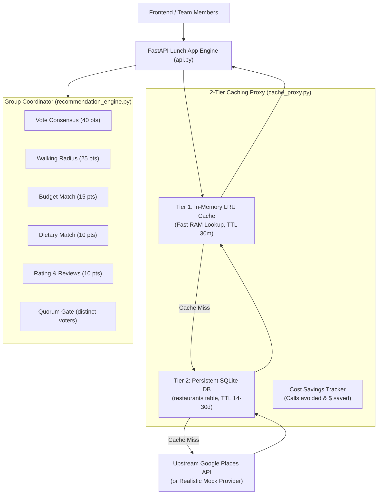
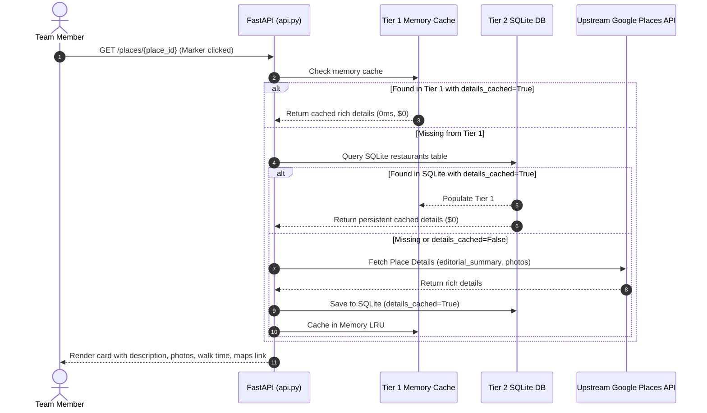

# Lunch App - Group Dining Decision Coordinator

A FastAPI-based team lunch voting coordinator and Google Places 2-tier caching proxy that solves the API cost vs. data completeness compromise.

---

## 1. Problem Context & Owen's Core Need

In prior iterations of the Lunch App (documented in `Wiki/Projects/Lunch App.md` and `Interaction Logs/2026-02-07 Node A Lunch App Place Details Compromise.md`), an agent had dropped place descriptions from restaurant cards to avoid expensive Google Places Place Details API calls ($25.00+ per 1,000 calls). The agent replaced descriptions with raw Google Maps links, degrading the user experience during rapid marker scanning.

### Owen's Core Heuristic
> *Do not drop the Description field or degrade restaurant cards because of API cost. Instead, implement a caching proxy that decouples lightweight nearby discovery from on-demand detail enrichment, storing rich metadata permanently.*

### The Solution: 2-Tier Caching Architecture
1. **Lightweight Nearby Discovery**: Fetches nearby candidates using inexpensive Google Nearby Search (coordinates, ratings, price level, address, and photo reference).
2. **Tier-1 In-Memory LRU Cache**: Fast (<1ms) memory cache with TTL for hot marker renders, active polls, and concurrent team voting.
3. **Tier-2 Persistent SQLite Cache**: Permanent local SQLite storage (`restaurants` table) preserving rich metadata, editorial summaries (`description`), full photos, dietary tags, and maps URLs.
4. **Lazy / On-Demand Enrichment**: Upstream Place Details is queried **only once** when a venue is first inspected or added to a poll; all subsequent views, voting sessions, and marker re-renders across the team hit local cache at **$0 API cost**.
5. **Group Decision Coordination**: Multi-criteria recommendation scoring (walking distance, price budget, dietary tags, ratings, and consensus votes) with quorum verification.

---

## 2. System Architecture



### Data Flow for Place Details & Marker Renders



---

## 3. Data Models (`models.py`)

### SQLite Tables (SQLAlchemy) & Pydantic Schemas

- **`Restaurant`**:
  - `id`: Google Place ID or unique key.
  - `name`, `address`, `latitude`, `longitude`.
  - `rating`, `user_ratings_total`, `price_level` (1 to 4).
  - `walking_distance_m`, `walking_time_mins` (calculated relative to office anchor).
  - `maps_url`, `photo_urls` (JSON list).
  - `description`: Rich editorial summary fetched via Tier-2 detail enrichment.
  - `dietary_tags`: Normalized tags (`vegetarian`, `vegan`, `halal`, `gluten-free`).
  - `cuisines`: List of cuisine categories.
  - `is_open_now`: Boolean.
  - `details_cached`: Flag indicating whether Tier-2 expensive enrichment was completed.
  - `cached_at`, `cache_expiry`: Expiration timestamps.

- **`LunchSession`**:
  - `id`: Session UUID.
  - `title`: e.g. "Friday Team Lunch".
  - `creator_name`: Initiator.
  - `status`: `"active"`, `"decided"`, or `"expired"`.
  - `office_lat`, `office_lon`: Anchor coordinates for walking radius calculations.
  - `quorum_needed`: Minimum distinct voters required to finalize a decision (e.g. 3).
  - `candidate_ids`: JSON array of restaurant IDs.
  - `winning_restaurant_id`: ID of winner once finalized.
  - `preference_filters`: Group-level filter constraints.

- **`MemberVote`**:
  - `id`: Vote UUID.
  - `session_id`, `member_name`, `restaurant_id`.
  - `vote_score`: Score from `1.0` (strong veto) to `5.0` (love it).
  - `comment`: Optional note or dietary feedback.

- **`PreferenceFilter`**:
  - `max_walking_minutes` (default 15) / `max_walking_distance_m` (default 1200m).
  - `price_levels`: Allowed price levels (e.g. `[1, 2]`).
  - `dietary_tags`: Required dietary accommodations (e.g. `["vegetarian", "vegan"]`).
  - `min_rating`: Minimum Google rating (default 3.5).
  - `require_open_now`: Boolean (default True).

---

## 4. Multi-Criteria Recommendation Algorithm (`recommendation_engine.py`)

Total candidate score is out of **100 points**:

$$\text{Total Score} = \text{Vote Score} + \text{Distance Score} + \text{Price Score} + \text{Dietary Score} + \text{Rating Score} - \text{Penalties}$$

| Component | Max Points | Evaluation Logic |
| :--- | :---: | :--- |
| **Team Consensus** | **40 pts** | Average member score $(\text{avg} / 5.0) \times 35 + \text{participation bonus}$ (up to +5). If unvoted, 0 pts. **Veto Penalty**: If any voter scores $\le 1.5$, applies a -10 pt penalty with explicit veto warning. |
| **Walking Radius** | **25 pts** | Haversine distance from office anchor. $\le 300\text{m} \implies 25\text{ pts}$. Linear decay to $5\text{ pts}$ at max distance. Beyond limit drops toward 0 with distance warning. |
| **Price Budget** | **15 pts** | Target price level match ($15\text{ pts}$), 1 step above ($7\text{ pts}$), 2+ steps above ($2\text{ pts}$). |
| **Dietary Match** | **10 pts** | Full match of requested team tags ($10\text{ pts}$), proportional partial match, or $0\text{ pts}$ if unmet. |
| **Rating & Reviews** | **10 pts** | Base rating score $(\text{rating} / 5.0) \times 8.0$ + review volume credibility bonus (up to $+2.0$). |
| **Open Now Gate** | **-25 pts** | Deducted if venue is currently closed when `require_open_now` is active. |

---

## 5. API Endpoints (`api.py`)

| Method | Path | Description |
| :--- | :--- | :--- |
| `GET` | `/places/search` | Nearby search with 2-tier caching. Returns basic places & cached status. |
| `GET` | `/places/{place_id}` | Rich details (description, photos, walk time) via Tier-1/Tier-2 cache. |
| `GET` | `/cache/stats` | Cache hit counts and estimated API dollar savings metrics. |
| `POST` | `/cache/clear` | Clear Tier-1 memory cache (Tier-2 SQLite preserved). |
| `POST` | `/sessions` | Create a new lunch voting session (auto-populates nearby if candidates omitted). |
| `GET` | `/sessions` | List all sessions. |
| `GET` | `/sessions/{id}` | Get session status, voter count, and candidates. |
| `POST` | `/sessions/{id}/vote` | Cast or update a member's vote (1.0 to 5.0 score + comment). |
| `GET` | `/sessions/{id}/votes` | List all votes cast in session. |
| `GET` | `/sessions/{id}/recommendations` | Get real-time scored and ranked candidate restaurants. |
| `POST` | `/sessions/{id}/decide` | Finalize session and declare winning venue (enforces quorum unless `force=true`). |

---

## 6. Setup and Verification

### Virtual Environment Setup
```bash
cd /Users/owenmartin/Documents/Gemini-export/work/projects/lunch_app
python3 -m venv .venv
source .venv/bin/activate
pip install -r requirements.txt
```

### Running the Test Suite
```bash
pytest -v tests/test_lunch_app.py
```

### Running the FastAPI Server
```bash
uvicorn api:app --reload --port 8000
```
- Interactive Swagger docs: `http://localhost:8000/docs`
- Cache stats: `http://localhost:8000/cache/stats`
